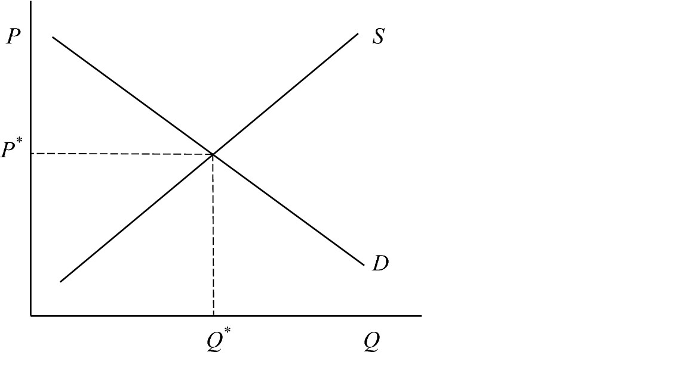
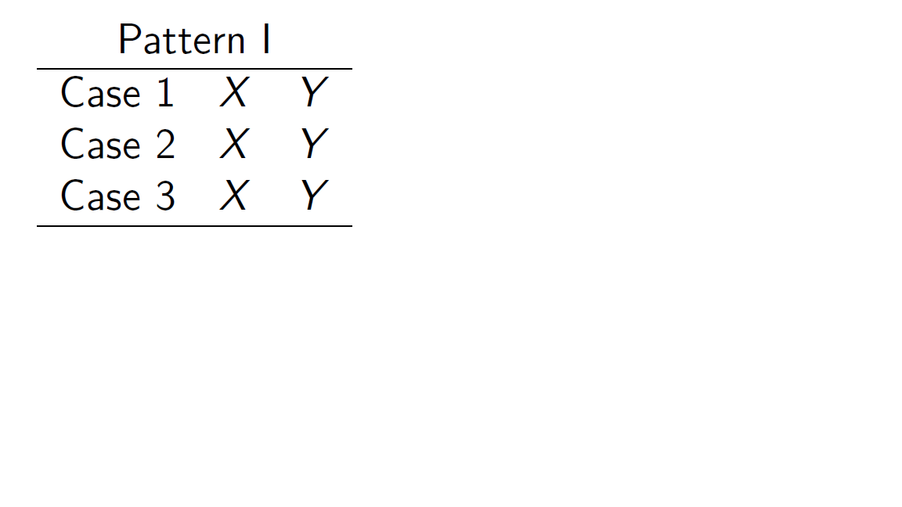
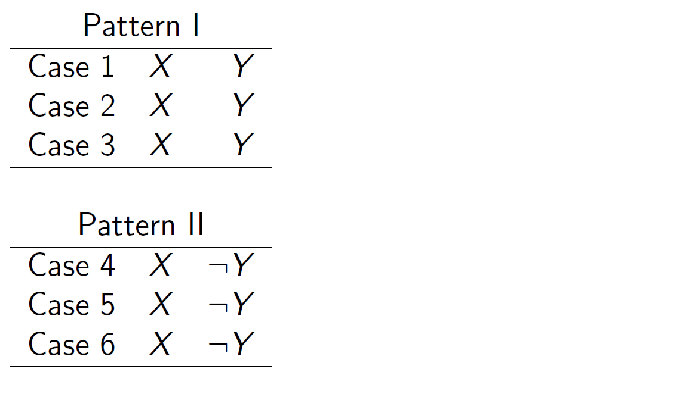
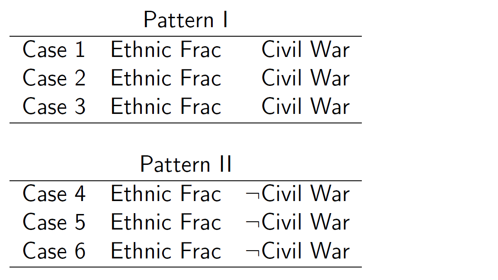
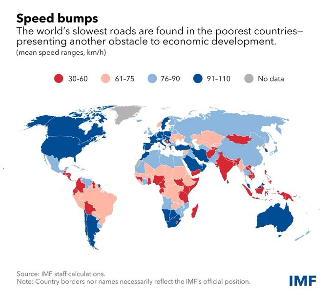
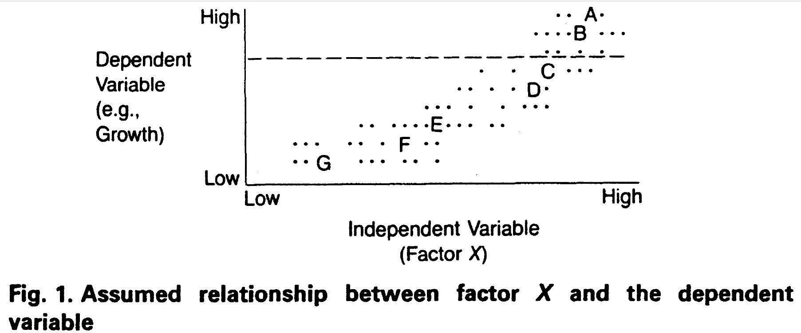
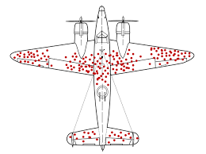

```{r  setup, message=FALSE, warning=FALSE, include=FALSE}
options(
  htmltools.dir.version = FALSE, # for blogdown
  width = 80,
  tibble.width = 80
)

knitr::opts_chunk$set(
  fig.align = "center",  warning=FALSE, message=FALSE
)

library(kableExtra)
library(tidyverse)
library(magrittr)


```

## Agenda

- Research Question

- Theory and Hypothesis

- Case selection

    - Selecting on the dependent variable

    - Selecting on the independent variable

- Case selection strategies
---
class: inverse, middle, center
# Research Question

---
## Research Question

Remember that a research question is general, it does not name specific places or policy areas. Also note that a research question must be open-ended, it is not a yes/no question.

- What are the causes of poverty?

- What is the relationship between indiscriminate attacks and civilian violence?

---
## How to Form a Research Question

- Observe people, institutions, and groups and speculate (model)
    
    - why they look the way they do.

- ‘Creative intuition’—personal experience and values.

- Look at conclusion sections of quantitative conflict papers;

- Look at journals that publish relevant research:

    - E.g.,American Journal of Political Science, American PoliticalScience Review, Journal of Politics, International Organization,International Studies Quarterly, Journal of Conflict Resolution,Journal of Peace Research, Political Science Research andMethods, Conflict Management and Peace Science, WorldPolitic, International Interactions, Foreign Policy Analysis
    
---
## How to Identify a Good Research Question

- Increase our collective ability to explain some aspect of the world:

1. Important hypothesis from literature that is not well answered;

2. A widely accepted hypothesis you think is incorrect;

3. Resolve a controversy in the literature;

4. Illuminate an unquestioned assumption;

5. Highlight an understudied topic and argue/demonstrate its importance;

6. Apply a theory or gather evidence from one area and apply to another.

---
class: inverse, middle, center
# Theory

---

## What is Theory?

- A series of statements that organize thinking to explain (and predict) patterns in the data.

- Consists of broad generalizations together with a set of assumptions or axioms and definitions of concepts

- Simplifies reality

- Explains facts and occurrences in a generalizable way 

- A theory provides an explanation of what to expect to see....or to not see
---
## Example: Price Theory


```{r, echo=F, out.width= "600px",fig.align="center"}

```

- What are the assumptions of this theory? 

- Are they true?

- Is this a useful theory?
---
## Theory-Building

- Start with something you know.

- Think of a logical explanation.

- Derive a novel prediction (something else that must be true if your theory is true)--that is your hypothesis.

---
## Example 1: Grad School Applications

- The quality of graduate applications decreases as the deadline approaches.

- Where is the process or causal mechanism? 

---
## Example 1: Grad School Applications

*Model 1* (Time Management): Students who delay are less prepared or organized. These students may underestimate the time needed to revise essays, request letters of recommendation, or navigate submission portals. As a result, last-minute applications may suffer from incomplete proofreading, weak coherence, or underdeveloped personal statements—not due to weaker ability, but due to poor execution.

  - *Hypothesis*: Late applicants will also tend to have last-minute recommendation letters.

*Model 2* (Selection Model): Application timing reflects underlying applicant quality: stronger, more confident applicants submit early, while weaker applicants delay. In contrast, weaker applicants may delay in hopes of improving their application, scrambling to raise test scores, secure recommenders, or polish materials they feel are not yet competitive.

  - *Hypothesis*: GPA/test scores of early applicants will be higher on average.


---
## Your Turn

- *Observation*: Civil wars happen in poor countries.

- Propose a model that explains this observation.

- Derive a testable implication.


---
class: inverse, middle, center
# Hypothesis

---
## Hypothesis

A hypothesis is a causal statement of the form: "As X increases[decreases], Y increases[decreases]."

- Democracies are less likely to go to war with each other.

- Resource-rich countries are more likely to be under-developed.

---
class: inverse, middle, center
# Case Selection
---

## Selection on the Dependent Variable


- Looking at cases where the outcome of interest does not vary

    - What problems arise from selecting on the dependent variable

---

## Selection on the Dependent Variable

Many look at event of interest Y to see if common cause X

```{r, echo=F, out.width= "1000px",fig.align="center"}

```

---
## Selection on the Dependent Variable

- The problem is that it may be that $X$ occurs even when $Y$ does not

- This problem arises if we select cases based on the dependent variable, that is, we only look at $Y$ but not $\neg Y$ .
 
```{r, echo=F, out.width= "1000px",fig.align="center"}

```
---
## Selection on the Dependent Variable
```{r, echo=F, out.width= "1000px",fig.align="center"}

```
---
## Example 

Example:A political party argues slower roads stifles economic development to justify raising speed limits;

```{r, echo=F, out.width= "600px",fig.align="center"}

```

- Why is using contemporary data on road speeds to access economic development a poor research design?

---
## Selection on the Dependent Variable
```{r, echo=F, out.width= "1000px",fig.align="center"}

```

- According to Geddes, what problems does selection bias createfor causal inference?

    - Applications: GRE/SAT scores & academic performance,sanction success.
    
---
## Selection on an Independent Variable

- Selection procedure does not predetermine the outcome of ourstudy;

- Selection on independent variable ok;

    - Note: this does not hold if IV correlates with factors associated with DV, e.g., Geddes’s East Asia/economic growth example.True also for control variables or even irrelevant variables

---
## Selection Due to Data Availability
```{r, echo=F, out.width= "500px",fig.align="center"}

```

---
## Selection Due to Data Availability

Information availability—often a form of truncated or censored data;

- Scholar specialization;

- Data lost to non-reporting, secrecy, or time;

- Problematic if correlated with dependent variable.

- Strategic processes result in censored data.

---
## Case Selection Strategies in Causal Studies

Goals:

1. Representative sample;

2. Useful variation on the dimensions of theoretical interest.

---
## Case Selection Strategies in Causal Studies

How to avoid selection bias?

- Random sample of target population;

- When is the random selection of cases problematic? 

How to find causal effects?

- Isolate factors of theoretical interest;

---
## Case Selection Strategies


- Typical cases;

- Diverse cases;

- Extreme cases;

- Deviant cases;

- Influential cases;

- Critical cases;

- Least-likely or “hard” cases;

- Most-similar design;

- Least-similar design;

- Cross-case and over-time design.

---
## Typical Cases

- Definition: Common of cross-case relationship within population

- Goal: Representative

- Large-N comparison: Along the regression line

- Causality: explore causal mechanisms (confirm or invalidate)

---
## Diverse Cases

- Definition: Diverse values of X, Y, or X/Y

- Goal: Maximize variance

- Large-N comparison:±1 or 2 standard deviation(s) from mean

- Causality: Confirmatory if focus is X/Y, exploratory if focus on X or Y

---
## Extreme Cases

- Definition: Extreme value on X or Y

- Goal: Investigate unusual case

- Large-N comparison: Several standard deviations from mean

- Causality: Exploratory

---
## Deviant Cases

- Definition: Outlier

- Goal: Understand why differs from others

- Large-N comparison: Large residual

- Causality: Refine theory (exploratory)

---
## Influential Cases

- Definition: Influence overall findings

- Goal: Examine assumptions

- Large-N comparison: leverage of a case, effect if case omitted

- Causality: Double-check causal mechanisms

---
## Critical Cases

- Definition: Substantively important case

- Goal: Investigate major case

- Large-N comparison: selecting on DV

- Causality: Explore multiple causal paths

---
## Least-likely or “Hard” Cases

- Definition: Case where conditions are especially difficult

- Goal: Stack deck against theory

- Large-N comparison: Bayesian updating

- Causality: Confirmatory

---
## Most-similar Design—Across Cases

- Definition: Cases that are similar on all factors except X and/orY

- Goal: Hold all else equal but key explanatory variable

- Large-N comparison: Experiments/matching

- Causality: Hypothesis testing (strong confirmatory)

---
## Most-similar Design—Within Case

- Definition: Look within-case over time

- Goal: Hold all else equal but key explanatory variable

- Large-N comparison: Time series/intervention analysis

- Causality: Hypothesis testing (strong confirmatory)

- Beware endogeneity, however.

---
## Least-similar Design

- Definition: Everything varies except for X and Y

- Goal: Rule out alternative explanations

- Large-N comparison: Inverse of matching

- Causality: Eliminate necessary conditions, confirm hypothesis

- Example: Global warming and species’ evolution (larger beaks,limbs, and ears)
---
## Cross-case and Over-time Design

- Definition: Treated and untreated cases before and after intervention

- Goal: Leverage temporal and spatial variation

- Large-N comparison: Difference-in-difference

- Causality: Hypothesis testing

---
## Your Turn

Jay is a recent U of T graduate working in the Ministry of Education. Correlating data on technology usage and education among primary students in Ontario, they found a negative relationship between screen time and test scores.


- Should the government base policy on this research? 

- What case selection strategy did Jay employ?

- How can Jay improve their research design?


